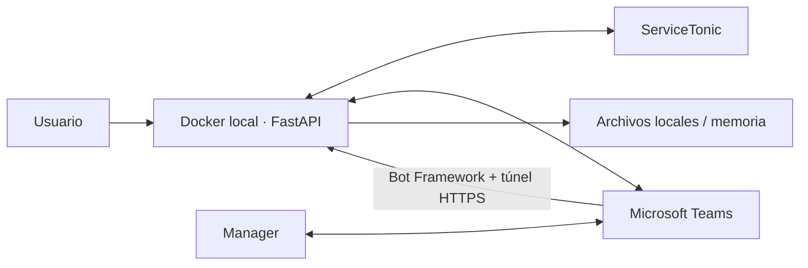

# Arquitectura de Valkiria ServiceTonic

> Arquitectura del PoC actualizada el 15 de octubre de 2026. ServiceTonic es
> el sistema de ticketing, Microsoft Teams gestiona aprobaciones y la aplicación
> se despliega localmente con Docker.

## Visión general

Valkiria recibe solicitudes de soporte en lenguaje natural, las clasifica,
consulta conocimiento, crea o actualiza tickets en
[ServiceTonic](https://www.servicetonic.com/es/ticketing-aplicacion/), aplica
políticas, solicita aprobaciones en Microsoft Teams y escala a soporte humano
con contexto. El PoC usa un LLM mock y persistencia local para reducir alcance.

## Stack del PoC

| Componente | Responsabilidad |
|---|---|
| Docker Compose | Ejecución local reproducible |
| FastAPI/Uvicorn | API, callbacks y frontend |
| Mock LLM | Orquestación determinista |
| Archivo/memoria | Conversaciones y aprobaciones de una instancia |
| ServiceTonic REST API | Tickets y trazabilidad |
| Teams Bot/Graph | Adaptive Cards y decisiones |
| Túnel HTTPS | Callback temporal hacia el equipo local |

## Componentes de aplicación

| Componente | Responsabilidad |
|---|---|
| FastAPI | REST, endpoint OpenAI-compatible, health y dashboard |
| Coordinador | Orquesta clasificación, diagnóstico, políticas y ejecución |
| Clasificador | Intención, categoría, grupo, impacto, urgencia y prioridad |
| Diagnóstico | Determina causa raíz y acción recomendada |
| Políticas | Decide autoservicio o aprobación |
| Ejecución | Ejecuta acciones autorizadas o genera trabajo técnico |
| Conocimiento | Recupera artículos de ServiceTonic y sintetiza respuestas |
| Escalación | Entrega resumen ejecutivo a Nivel 2/3 |
| Métricas | Responde consultas operativas y alimenta el dashboard |

## Integraciones oficiales

### ServiceTonic

Sistema de registro para tickets, estados, prioridades, SLA, categorías,
historial, base de conocimiento y seguimiento. La API y los catálogos exactos
deben confirmarse con el proveedor antes de implementar el adaptador productivo.

### Microsoft Teams

Canal único de notificaciones y aprobaciones. Las Adaptive Cards permiten
aprobar o rechazar y el callback reanuda la conversación de forma idempotente.

### Google Cloud

Fuera del alcance del PoC. Se conserva como alternativa de industrialización
posterior, sin afectar la demostración local.

## Principios

- Puertos antes que adaptadores.
- Configuración por entorno y mínimo privilegio.
- Sin secretos en código, variables planas o estado Terraform.
- Modo mock determinista para pruebas sin red.
- Despliegues sin tráfico, smoke test y promoción posterior.
- PII y secretos saneados antes de Logging/BigQuery.
- Ninguna acción reporta éxito sin confirmación del sistema ejecutor.

Ver también [modelo C4](c4/00_INDICE.md), [seguridad](SEGURIDAD.md) y
[despliegue GCP](DESPLIEGUE_GCP.md).
