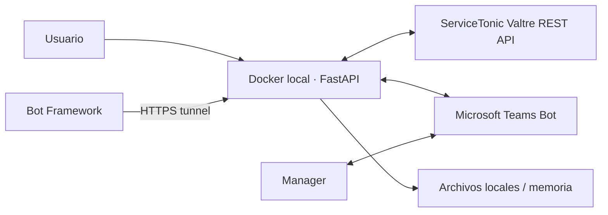

# PoC local — ServiceTonic y Microsoft Teams

> Alcance vigente del proyecto. Google Cloud queda fuera del PoC y se conserva
> únicamente como roadmap posterior.

## Objetivo

Demostrar localmente un flujo completo y acotado:

1. El usuario solicita un ticket.
2. Valkiria crea/consulta/actualiza el ticket en ServiceTonic Valtre.
3. Si requiere aprobación, envía una Adaptive Card al manager en Teams.
4. El manager aprueba o rechaza.
5. Valkiria reanuda la conversación y actualiza el ticket ServiceTonic.

## Alcance incluido

- FastAPI ejecutándose en Docker local.
- Proveedor LLM `mock` para comportamiento determinista y sin nube.
- Persistencia local de conversaciones y aprobación en una sola instancia.
- API REST ServiceTonic v1.
- Microsoft Teams Bot para botones Aprobar/Rechazar.
- Túnel HTTPS temporal para el callback de Bot Framework.
- Autenticación API key, RBAC, CORS, rate limit, redacción y auditoría.

## Fuera de alcance

- Vertex AI y cualquier otro modelo cloud.
- Cloud Run, Firestore, BigQuery, Logging, Monitoring y Terraform.
- Alta disponibilidad o múltiples instancias.
- Base de conocimiento productiva.
- Autoservicio real de contraseñas, cuentas o licencias.
- Carga, SLO, Cloud Armor y operación productiva.

## Arquitectura



## Prerrequisitos

### ServiceTonic

- `idProject` del servicio de pruebas.
- Agente técnico de mínimo privilegio.
- Equipo autorizado.
- Nombres reales de campos de ticket.
- Contacto y ticket de prueba.
- Manager de prueba con correo de Microsoft 365 y la app Teams instalada.
- Autorización para crear/modificar tickets marcados como PoC.

### Microsoft Teams

- App registrada en Entra ID.
- Azure Bot con canal Teams.
- App instalada para el manager de prueba.
- `Application ID`, secreto y tenant ID.
- Túnel HTTPS hacia el puerto local 8000.

### Local

- Docker Engine 24+ y Docker Compose v2.
- Puerto 8000 disponible.
- Tres API keys locales (`user`, `agent`, `admin`).

## Configuración

```bash
cp .env.poc.example .env.poc
```

Completar `.env.poc` sin compartir ni versionar secretos. Los campos dinámicos
de ServiceTonic se configuran mediante `SERVICETONIC_FIELD_MAP`. Para mantener
el PoC acotado, `POC_MANAGER_NAME` y `POC_MANAGER_EMAIL` fijan el aprobador de
la demostración; una versión posterior puede resolverlo desde contactos/Graph.

Levantar:

```bash
make poc-up
make poc-logs
```

Detener:

```bash
make poc-down
```

## Túnel y Teams

El bot necesita un endpoint HTTPS público temporal. Crear un túnel autorizado
hacia `http://localhost:8000` y configurar en Azure Bot:

```text
https://<tunnel>/api/teams/messages
```

El túnel solo debe permanecer activo durante la demostración. La API mantiene
autenticación propia y `/api/teams/messages` valida el JWT de Bot Framework.

## Prueba previa ServiceTonic

Antes del flujo de escritura, ejecutar la prueba contractual de solo lectura:

```text
Actions → Probar contrato ServiceTonic
```

O localmente, exportando las variables sin imprimirlas:

```bash
python scripts/probe_servicetonic.py
```

## Criterios de aceptación

- Autenticación ServiceTonic exitosa.
- Ticket PoC creado con contacto, equipo y campos correctos.
- La petición de chat usa como `caller` el identificador real del contacto de prueba.
- Ticket recuperable y actualizable.
- Manager recibe tarjeta en Teams.
- Solo el manager registrado puede decidir.
- Segundo clic no repite la acción.
- Aprobación actualiza conversación y ticket.
- Rechazo deja comentario/estado trazable.
- Ninguna credencial o PII cruda aparece en logs.

## Limitaciones conocidas

- La API pública no expone KB, catálogos, manager ni webhooks.
- El mapeo de campos depende de la plantilla Valtre.
- La persistencia de aprobaciones es local y de una instancia.
- El modo mock valida orquestación, no calidad de un modelo generativo.
- El túnel local no representa una topología productiva.
