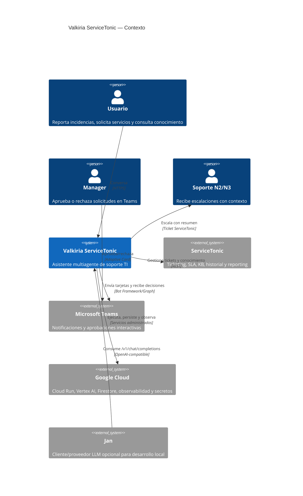

# Nivel 1 — Contexto

## Sistemas externos

| Sistema | Uso | Estado |
|---|---|---|
| ServiceTonic | Sistema único de registro y conocimiento | API/sandbox pendientes |
| Microsoft Teams | Canal único de aprobación | Código listo; tenant pendiente |
| Google Cloud | Plataforma completa de producción | IaC listo; proyectos pendientes |
| Jan | Desarrollo local opcional | Soportado |
