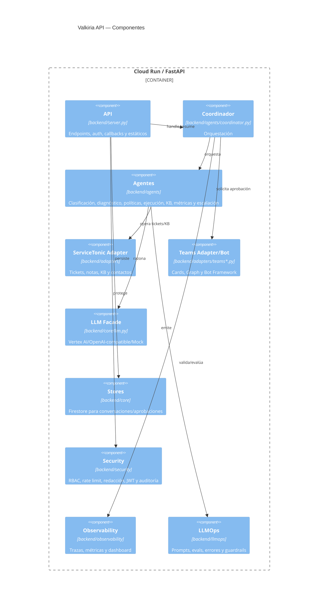

# Nivel 3 — Componentes

## Nota de implementación

El contrato objetivo es neutral y ServiceTonic es el único proveedor
productivo. Cualquier identificador heredado que persista en código es deuda
técnica del incremento I1 y no define la arquitectura funcional.
