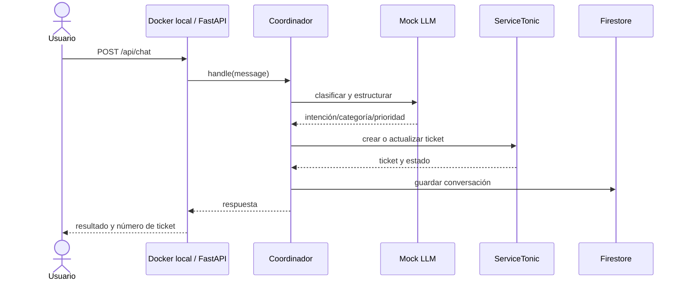
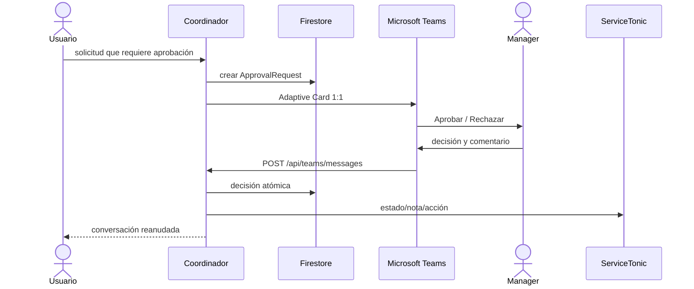

# Nivel 4 — Código y secuencias

## Flujo de ticket



## Flujo de aprobación Teams



## Estados principales

```text
in_progress → awaiting_approval → resolved
                              └→ rejected
in_progress → escalated
```

## Contratos objetivo

- `TicketingPort`: crear, leer, listar y actualizar tickets; notas; KB; manager.
- `NotifierPort`: avisos y aprobaciones Teams.
- `ConversationStorage`: persistencia de conversaciones.
- `ApprovalStorage`: persistencia y decisión idempotente.
- `LLM`: proveedor mock determinista durante el PoC.
